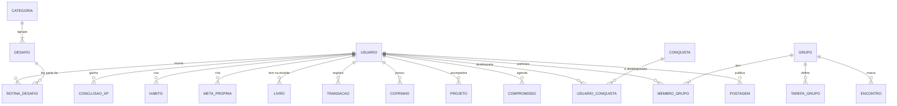
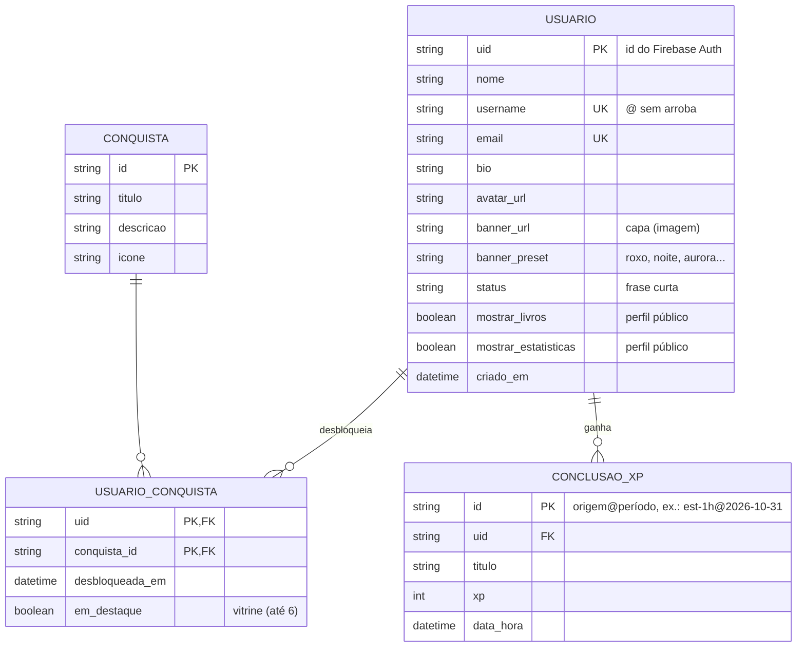
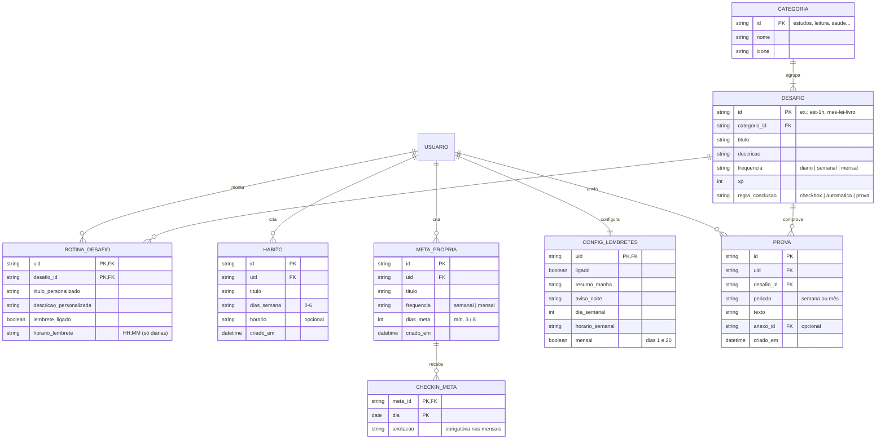
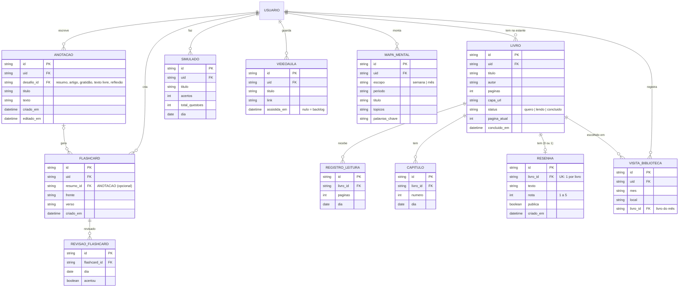
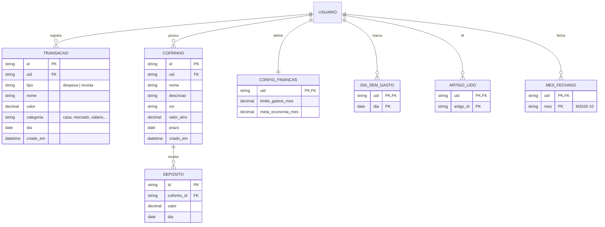
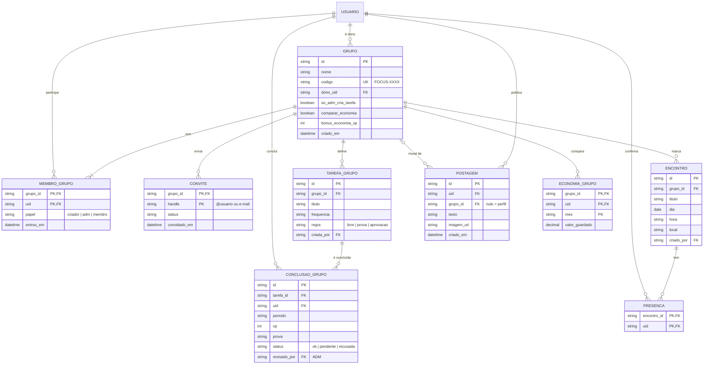

# DER — Focus

Diagrama Entidade-Relacionamento do Focus, tirado do código atual (`context/`, `services/`, `constants/`).

- **Modelo lógico.** Hoje o app guarda tudo no aparelho, em AsyncStorage, por usuário. A estrutura já é a que vai para o **Firebase (Firestore)**: cada entidade vira uma coleção ou subcoleção (ver o mapeamento no fim).
- **Notação.** Pé de galinha (crow's foot), com PK = chave primária, FK = chave estrangeira e UK = única.
  - `||--o{` lê-se "um para zero ou muitos".
  - `||--|{` lê-se "um para um ou muitos".
  - `|o--o{` indica uma FK opcional.
- **Como gerar a imagem.** Cole cada bloco em <https://mermaid.live> e exporte em PNG ou SVG. Outra opção é abrir `DER_Focus.html` no navegador, que tem um botão de download por diagrama.

---

## 0. Visão geral (entidades principais)

---

## 1. Usuário e gamificação

> O nível, a sequência de dias e o XP da semana **não são guardados**: são calculados a partir de `CONCLUSAO_XP`. O id com período (dia, semana ou mês) impede ganhar XP duas vezes pela mesma tarefa.

---

## 2. Rotina, desafios, hábitos e lembretes

---

## 3. Estudos e leitura

---

## 4. Finanças (funções do Squill)

---

## 5. Grupos e social

---

## 6. Planejamento e bem-estar

```mermaid
erDiagram
    COMPROMISSO {
        string id PK
        string uid FK
        string titulo
        date dia
        string hora
        string tipo "compromisso | prova | prazo"
        string observacao
        boolean avisar
    }
    PROJETO {
        string id PK
        string uid FK
        string tipo "curso | projeto | criacao | aprender"
        string titulo
        string descricao
        date inicio
        date prazo
        int carga_horaria
        datetime concluido_em
    }
    PROGRESSO_PROJETO {
        string id PK
        string projeto_id FK
        string texto
        date dia
    }
    ANEXO {
        string id PK
        string uid FK
        string dono_tipo "projeto | mapa | desafio | prova"
        string dono_id
        string url
        string nome
        string tipo "imagem | documento"
    }
    CARTAO_META {
        string id PK
        string uid FK
        string titulo
        string motivo
        string mes "nulo = geral"
    }
    REVISAO_META {
        string cartao_id PK,FK
        string semana PK
        string resultado "no caminho | ajustar"
    }
    CONFIG_SONO {
        string uid PK,FK
        string hora_dormir
        string hora_acordar
        boolean despertador_ligado
        string som_url
        string playlist_url
        int soneca_min
    }
    REGISTRO_SONO {
        string uid PK,FK
        date dia PK
        string dormiu
        string acordou
        decimal horas
    }
    REFEICAO {
        string id PK
        string uid FK
        string semana
        int dia_semana
        string turno "café | almoço | lanche | jantar"
        string descricao
        int kcal
    }
    TREINO_DIA {
        string uid PK,FK
        date dia PK
    }
    CORRIDA {
        string id PK
        string uid FK
        decimal km
        int minutos
        date dia
    }
    HOBBY {
        string id PK
        string uid FK
        string nome
    }
    REGISTRO_HOBBY {
        string id PK
        string hobby_id FK
        int minutos
        string anotacao
        date dia
    }
    PESSOA {
        string id PK
        string uid FK
        string nome
    }
    CONTATO_PESSOA {
        string id PK
        string pessoa_id FK
        string desafio_id FK "mensagem | elogio"
        date dia
    }
    PENDENCIA {
        string id PK
        string uid FK
        string titulo
        date prazo "vencida = atrasada"
        datetime feita_em
    }
    MEDICAO {
        string uid PK,FK
        string desafio_id PK,FK "passos, tempo de tela"
        date dia PK
        int valor
    }
    USUARIO ||--o{ COMPROMISSO : agenda
    USUARIO ||--o{ PROJETO : acompanha
    PROJETO ||--o{ PROGRESSO_PROJETO : registra
    USUARIO ||--o{ ANEXO : envia
    USUARIO ||--o{ CARTAO_META : cria
    CARTAO_META ||--o{ REVISAO_META : revisado
    USUARIO ||--|| CONFIG_SONO : configura
    USUARIO ||--o{ REGISTRO_SONO : registra
    USUARIO ||--o{ REFEICAO : planeja
    USUARIO ||--o{ TREINO_DIA : marca
    USUARIO ||--o{ CORRIDA : registra
    USUARIO ||--o{ HOBBY : tem
    HOBBY ||--o{ REGISTRO_HOBBY : registra
    USUARIO ||--o{ PESSOA : lista
    PESSOA ||--o{ CONTATO_PESSOA : recebe
    USUARIO ||--o{ PENDENCIA : anota
    USUARIO ||--o{ MEDICAO : mede
```

---

## Regras de negócio que aparecem no modelo

1. **XP sem duplicar:** o `id` de `CONCLUSAO_XP` junta a origem e o período (`est-1h@2026-10-31`, `pro-meta@S2026-10-27`, `mes-lei-livro@M2026-10`). Como ele é a PK, a mesma tarefa só conta uma vez por período.
2. **Semanais e mensais** não são concluídas por clique. A conclusão depende do registro ligado a elas, por exemplo:
   - `SIMULADO` (pelo menos 5 questões);
   - `REFEICAO` (5 dias planejados);
   - `REGISTRO_SONO` (5 ou 20 noites com até 1 h de diferença);
   - `PROGRESSO_PROJETO` (3 dias diferentes);
   - `PROVA` (texto de 15 ou mais letras, ou uma foto).
3. **Metas próprias** (`META_PROPRIA`):
   - no máximo 3 por frequência;
   - mínimo de 3 dias (semanal) ou 8 dias (mensal);
   - um `CHECKIN_META` por dia, ou seja, PK (meta, dia);
   - valem metade do XP de um desafio do catálogo.
4. **Grupos:**
   - **Quem pode o quê:** o papel `criador` sempre é ADM. Só ele promove ou tira ADM. Um ADM remove membros e aprova as `CONCLUSAO_GRUPO` com `status = pendente`.
   - **Encontros:** um `ENCONTRO` aparece no `COMPROMISSO`/agenda de quem tem `PRESENCA`.
5. **Resenha:** só para `LIVRO` com `status = concluido`, e no máximo uma por livro.

---

## Mapeamento para o Firestore (integração futura)

| Entidade | Coleção |
|---|---|
| USUARIO | `users/{uid}` (+ `usernames/{username}` → `{uid, email}` para garantir o @ único e o login por @) |
| Perfil público | `users/{uid}/publico/perfil` (só os campos liberados) |
| CONCLUSAO_XP, USUARIO_CONQUISTA | `users/{uid}/xp/{id}`, `users/{uid}/conquistas/{id}` |
| ROTINA_DESAFIO, HABITO, META_PROPRIA (+ checkins) | `users/{uid}/rotina/{desafioId}`, `users/{uid}/habitos/{id}`, `users/{uid}/metas/{id}/checkins/{dia}` |
| LIVRO (+ leituras, capítulos, resenha) | `users/{uid}/livros/{id}/leituras/{id}` |
| TRANSACAO, COFRINHO (+ depósitos) | `users/{uid}/transacoes/{id}`, `users/{uid}/cofrinhos/{id}/depositos/{id}` |
| Demais registros do usuário | `users/{uid}/<lista>/{id}` (anotações, flashcards, compromissos, projetos, sono…) |
| GRUPO e filhos | `grupos/{id}`, `grupos/{id}/membros/{uid}`, `/tarefas`, `/conclusoes`, `/encontros`, `/posts`, `/economia` |
| DESAFIO, CATEGORIA, CONQUISTA | ficam no app (`constants/`); são catálogo fixo, não precisam de coleção |
| ANEXO | arquivo no Firebase Storage; o documento guarda só a `url` |
