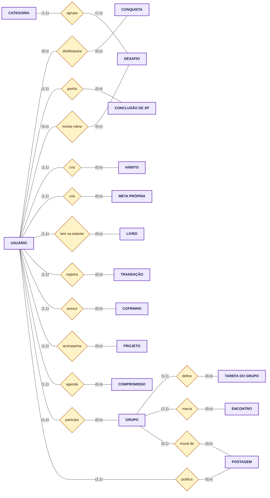
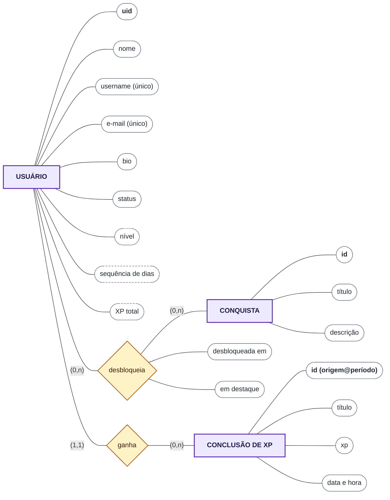
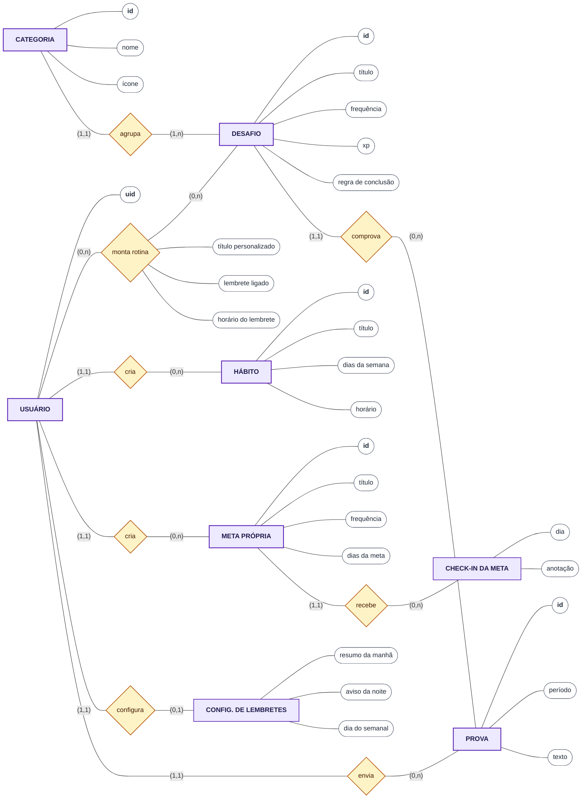
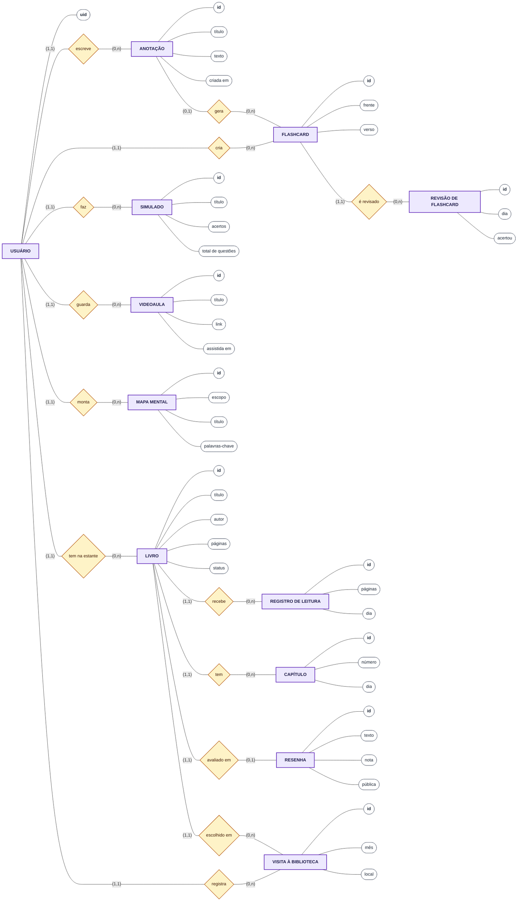
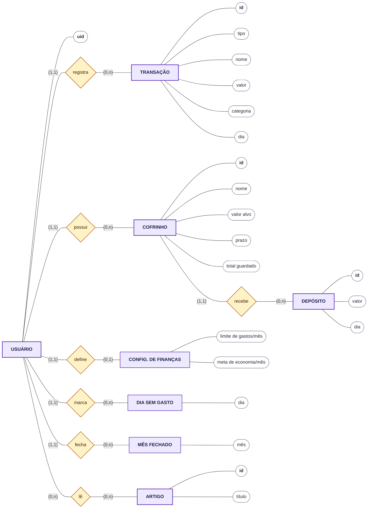
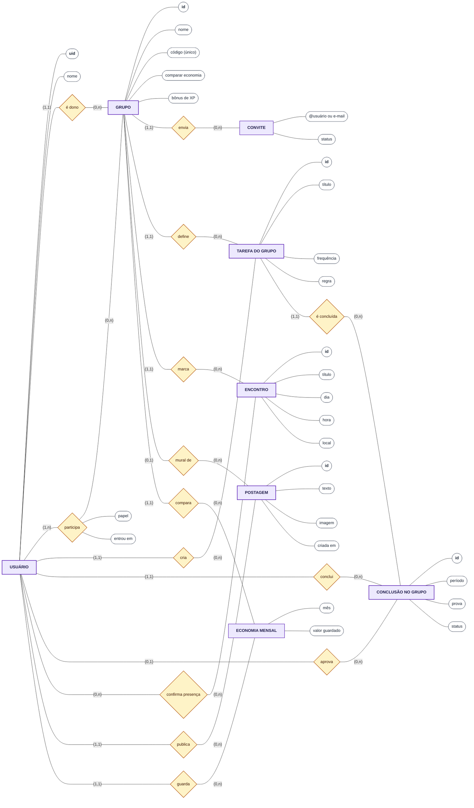
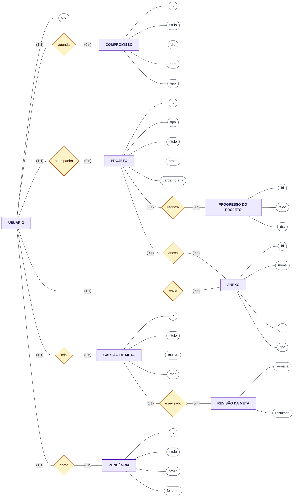
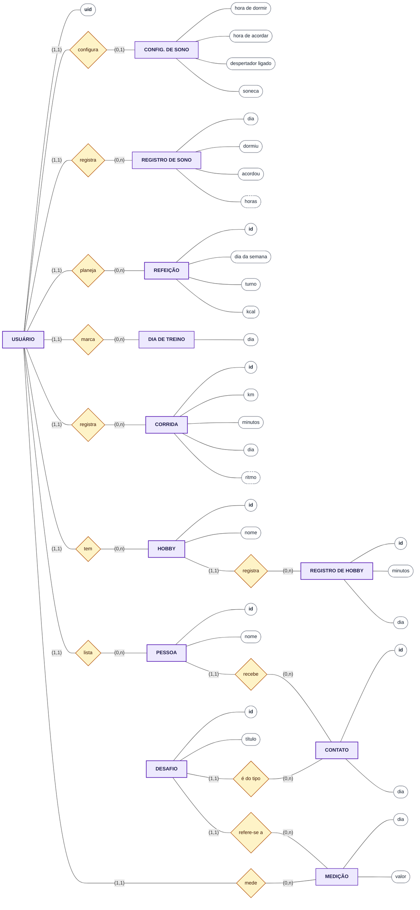

# MER — Focus

Modelo Entidade-Relacionamento (**modelo conceitual**) do Focus. É a visão de alto nível que antecede o DER (`6_DER.md`, modelo lógico): mostra **o que** o sistema guarda e como as coisas se relacionam, sem tipos de dados nem chaves estrangeiras.

## Notação (Peter Chen, com cardinalidade de Heuser)

| Símbolo | Significado |
|---|---|
| Retângulo | Entidade |
| Retângulo duplo | Entidade fraca (só existe ligada a outra; identificada pela dona + chave parcial) |
| Losango | Relacionamento |
| Losango duplo | Relacionamento identificador (liga a entidade fraca à dona) |
| Elipse | Atributo |
| Elipse com nome sublinhado | Atributo identificador (chave) |
| Sublinhado tracejado | Chave parcial da entidade fraca |
| Elipse tracejada | Atributo derivado (calculado, não guardado) |
| Elipse dupla | Atributo multivalorado |
| `(mín,máx)` | Cardinalidade: quantas ocorrências **daquela entidade** se ligam a uma ocorrência da outra |

Exemplo de leitura: `USUÁRIO (1,1) — cria — (0,n) HÁBITO` significa que um usuário cria de zero a muitos hábitos e que cada hábito pertence a exatamente um usuário.

Para ver os diagramas desenhados (retângulos e losangos duplos, sublinhados), abra `MER_Focus.html` no navegador e use “Baixar PNG”. Os blocos abaixo também abrem em <https://mermaid.live>, mas sem os contornos duplos e os sublinhados, que o HTML acrescenta.

---

## 0. Visão geral

Entidades principais e como se relacionam. Os atributos aparecem nos diagramas de cada módulo.

---

## 1. Usuário e gamificação

Nível, sequência e XP total são derivados: calculados a partir das conclusões de XP, não guardados.

---

## 2. Rotina, desafios, hábitos e lembretes

“Monta rotina” é N:N com atributos: o nome e o lembrete personalizados pertencem à ligação usuário–desafio.

---

## 3. Estudos e leitura

Uma resenha é opcional e única por livro (0,1). Um flashcard pode nascer de um resumo (anotação) ou ser avulso.

---

## 4. Finanças (funções do Squill)

Dia sem gasto e mês fechado só existem ligados a um usuário: são entidades fracas identificadas pela data.

---

## 5. Grupos e social

“Participa” guarda o papel (criador, ADM ou membro). A economia mensal é fraca e depende do grupo e do usuário ao mesmo tempo.

---

## 6. Planejamento

Anexos também podem pertencer a mapas mentais e provas; aqui aparece a ligação com projetos.

---

## 7. Bem-estar

As horas de sono e o ritmo da corrida são derivados. A medição (passos, tempo de tela) depende do usuário e do desafio.

---

## Do MER para o DER (o que muda no modelo lógico)

| No MER (conceitual) | No DER (lógico) |
|---|---|
| Relacionamento N:N com atributos: `desbloqueia`, `monta rotina`, `participa`, `confirma presença`, `lê` | Vira tabela associativa: `USUARIO_CONQUISTA`, `ROTINA_DESAFIO`, `MEMBRO_GRUPO`, `PRESENCA`, `ARTIGO_LIDO` (PK composta pelas duas FKs) |
| Relacionamento 1:N | A entidade do lado N recebe a FK (`uid`, `livro_id`, `grupo_id`…) |
| Entidade fraca + relacionamento identificador | PK composta: chave da dona + chave parcial (ex.: `CHECKIN_META (meta_id, dia)`, `ECONOMIA_GRUPO (grupo_id, uid, mes)`) |
| Entidade fraca 1:1 (configurações) | PK = FK do usuário (`CONFIG_LEMBRETES.uid`, `CONFIG_FINANCAS.uid`, `CONFIG_SONO.uid`) |
| Atributo multivalorado (`dias da semana`, `palavras-chave`) | Guardado como lista no documento do Firestore |
| Atributo derivado (`nível`, `sequência`, `XP total`, `horas`, `ritmo`, `total guardado`) | Não é coluna: o app calcula a partir dos registros |

## Regras de negócio representadas

1. Um usuário ganha XP de uma tarefa no máximo uma vez por período. A chave de `CONCLUSÃO DE XP` é `origem@período`.
2. Cada livro tem no máximo uma resenha (0,1), e só pode ter resenha depois de concluído.
3. Toda conclusão no grupo pertence a uma tarefa e a um usuário. Quando a regra é “ADM aprova”, um ADM fica ligado a ela pelo relacionamento `aprova` (0,1).
4. Todo grupo tem pelo menos um participante (1,n), o criador, que sempre é ADM.
5. Uma postagem pode estar no mural de um grupo (0,1) ou só no perfil.
